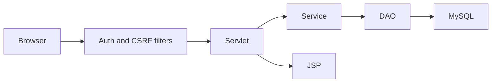

# Architecture

The web application follows Presentation → Servlet → Service → DAO → JDBC. Servlets load or validate request data, services own business rules, and DAOs own SQL. `AuthFilter` enforces the role boundary before protected pages render.

The Swing client shares the DAO layer and is intentionally separate from JSP concerns. `ComplaintClassifier` is deterministic and explainable so a student can demonstrate the decision process during assessment.

`ComplaintService` validates the lifecycle (`SUBMITTED → ANALYZED/ASSIGNED → IN_PROGRESS → RESOLVED → CLOSED`) and groups related complaint/history writes in a single JDBC transaction. Authentication verifies PBKDF2 or legacy SHA-256 hashes, rotates the session after login, and upgrades legacy hashes. Ownership and assignment checks protect individual complaint records; all dynamic POST forms require a per-session CSRF token.
